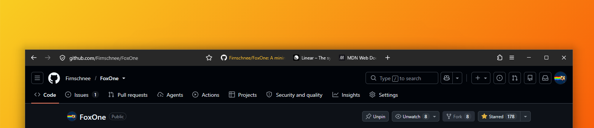

# FoxOne

One-line layout, hover-reveal icons, dynamic bookmarks bar, floating Findbar, Gruvbox colors and ready for **Nova**

> Tested with Firefox 159 & 153 ESR on Windows, macOS and Linux (GNOME) with `browser.nova.enabled` = `true`.     

**[Install](https://firnschnee.github.io/FoxOne/installation.html)** | **[Customise](https://firnschnee.github.io/FoxOne/customisation.html)** | **[See it in action](https://firnschnee.github.io/FoxOne/action.html)**

Over 40 variables for colors, layout and toggles and it also works with [Adaptive Tab Bar Colour](https://addons.mozilla.org/de/firefox/addon/adaptive-tab-bar-colour/).     

Using Thunderbird? Take a look at [BirdOne](https://github.com/Firnschnee/BirdOne).

Special shoutout to:
> - [@NeroWolfe75](https://github.com/NeroWolfe75) – bug hunting, ideas and the urlbar and corner fixes
> - [@snkiz](https://github.com/snkiz) – sidebar launcher and F11 fixes, nav button options and the extension cluster
> - [@atrehhoff](https://github.com/atrehhoff) – new tab button, spacing and macOS testing
> - [@DeathMurderGod](https://github.com/DeathMurderGod) – minimum tab width and the original auto-hide nav buttons

Missing something or found a bug? Open an [Issue](https://github.com/Firnschnee/FoxOne/issues) or a PR.

---
Built on [Cascade](https://github.com/cascadefox/cascade). Floating Findbar and dynamic bookmarks bar adapted from [LittleFox](https://github.com/biglavis/LittleFox). License: [MIT](LICENSE)
